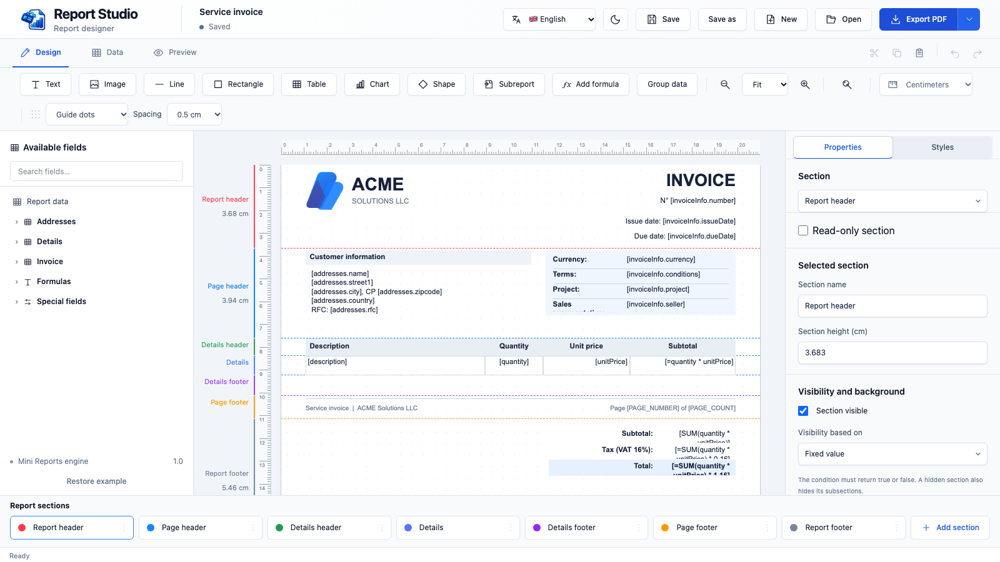
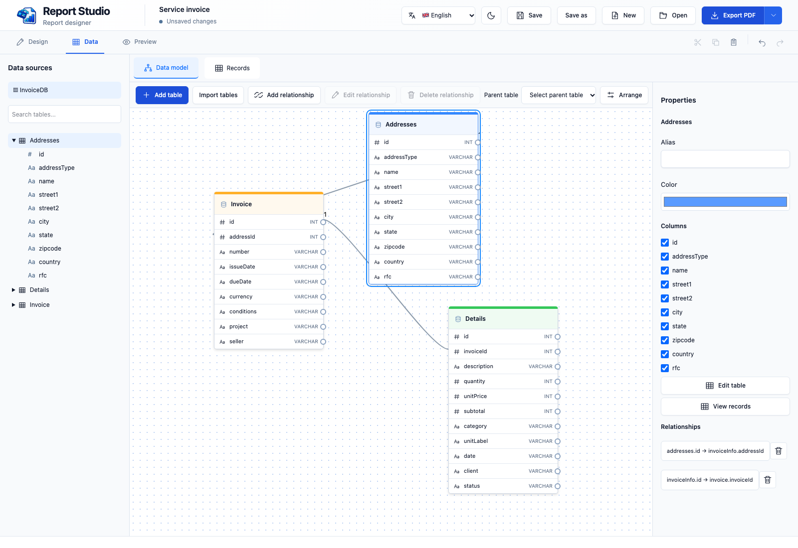
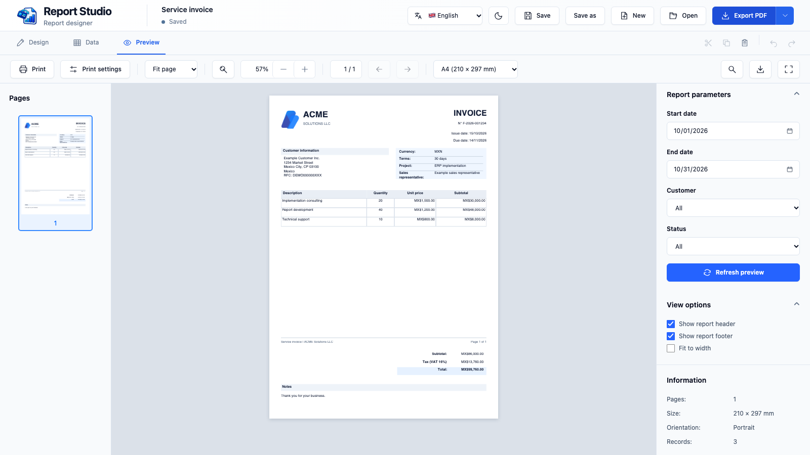

[English](README.md) · [Español](README.es.md) · [Français](README.fr.md)

# IntelligentReports Studio

Diseñado y creado por **Luigimonsoft**.

Creado con **Tauri 2** para macOS, Windows y Linux.

**Diseña reportes con tus datos y llévalos del lienzo a PDF.**



IntelligentReports Studio es un diseñador de reportes de escritorio para crear documentos reutilizables basados en datos. Puedes construir una factura, un listado u otro reporte visualmente, enlazar sus campos con tablas y revisar el resultado antes de exportarlo. El diseño se guarda como una plantilla JSON que puedes abrir y modificar después.

### Funciones principales

- **Diseño visual:** organiza textos, imágenes, líneas, formas, tablas y gráficos en secciones del reporte, página y detalles. Ajusta propiedades, estilos, reglas y guías.
- **Modelo de datos:** define tablas y campos, conecta relaciones y consulta registros. Importa definiciones y datos desde JSON o proporciona datos mediante una integración.
- **Contenido dinámico:** enlaza campos, usa fórmulas y parámetros, agrupa detalles y controla la visibilidad y el fondo de las secciones.
- **Vista previa y distribución:** revisa páginas, ajusta la vista, imprime y exporta el PDF.
- **Interfaz adaptable:** disponible en español, inglés y francés, con temas claro y oscuro.

### Modela y proporciona tus datos

En **Modelo de datos**, crea tablas y define sus campos y tipos desde el editor. Organiza las tablas visualmente y conecta columnas para establecer relaciones. También puedes importar definiciones de tablas y registros opcionales desde un archivo JSON, o pegar el JSON en el diálogo de importación.



Usa **Registros** para consultar y editar los datos disponibles. Después, en **Diseño**, arrastra campos al reporte o enlázalos con una tabla o sección de detalles. La vista previa utiliza los registros disponibles para completar el reporte. El guardado normal conserva el esquema y el nombre de la fuente, pero excluye los registros; una integración puede proporcionar los datos nuevamente cuando se necesiten.

### Del lienzo a la vista previa

Crea un reporte como en otras herramientas de diseño visual: arrastra campos y elementos a la hoja, muévelos entre secciones y ajusta sus propiedades y estilos. Conecta el diseño a tus datos y abre **Vista previa** para ver las páginas resultantes con los campos, las fórmulas y los registros repetidos resueltos. Así puedes revisar el resultado antes de imprimirlo o exportarlo a PDF.



### Cómo funciona

1. En **Diseño**, organiza la página y sus secciones; agrega elementos y configura su contenido y apariencia.
2. En **Datos**, define tablas, campos, relaciones y parámetros. Las secciones o tablas pueden repetir contenido para cada registro.
3. En **Vista previa**, el motor combina plantilla y datos, evalúa expresiones y distribuye las páginas. La vista previa y la exportación utilizan la misma generación de PDF.
4. Guarda la plantilla JSON para editarla después. El guardado normal conserva el diseño y las definiciones de datos, pero excluye los registros y los valores de parámetros marcados para no guardarse. Las copias de recuperación son locales y pueden contener datos de la sesión.

Tauri gestiona la ventana y las operaciones del sistema; Leptos presenta la interfaz y el motor integrado procesa datos, validación y páginas. Durante el desarrollo se carga una factura de ejemplo; la versión de distribución inicia con un reporte en blanco.

## Requisitos e inicio

Instala Rust, Node.js, Tauri CLI 2, Trunk 0.21.14 y wasm-bindgen-cli 0.2.126, además de los [requisitos de Tauri](https://v2.tauri.app/start/prerequisites/).

```sh
rustup target add wasm32-unknown-unknown
cargo install --locked trunk --version 0.21.14
cargo install --locked wasm-bindgen-cli --version 0.2.126
cargo install tauri-cli --version '^2'
cargo tauri dev
```

`cargo tauri dev`, `cargo tauri build` y `node scripts/frontend.mjs` compilan automáticamente el motor antes de Trunk. Si faltan las dependencias fijadas del motor o cambiaron, el script ejecuta `npm ci` en `runtime/` (la primera instalación puede requerir conexión). La aplicación empaquetada funciona sin Node.js. No es necesario incluir en Git los archivos generados `chunk-*.js` y `sample-*.js`.

Para compilar una versión distribuible, ejecuta `cargo tauri build`. Si trabajas en un disco externo con archivos auxiliares `._*`, puedes usar `node scripts/clean-build.mjs dev` para iniciar desde una copia temporal.

Las plantillas JSON guardan definiciones de tablas y nombres de fuentes, pero no registros. Las copias de recuperación son locales y pueden contener los datos de la sesión.

Consulta el [README principal](README.md) para la estructura y los comandos de pruebas.

El JSON guardado usa `schemaVersion: 1`. Las plantillas anteriores sin esta propiedad se interpretan como versión 1; las versiones de esquema no compatibles se rechazan. Los campos existentes `version` en la raíz y `report.version` siguen siendo obligatorios.

Al importar JSON, activa **Expandir JSON anidado en tablas relacionadas** para convertir una ruta como `customer.name` en una columna editable como `customer_name`, e `items[].price` en una columna de una tabla hija relacionada. El esquema conserva la ruta original en `sourcePath`; las expresiones del reporte usan el nombre de columna generado. Los arreglos deben contener objetos. Un arreglo vacío produce una tabla relacionada vacía con claves generadas. Los datos permanecen solo en la sesión.

En **Diseño → Campos disponibles → Plantillas de ejemplo** puedes elegir una factura, cotización, lista de productos o reporte de ventas. Los ejemplos usan datos editables de sesión; las plantillas guardadas no incluyen registros.

Las secciones principales de detalles y el pie del reporte admiten `pageBreakBefore: true` para comenzar en una página nueva. En un detalle repetido, el salto se aplica a cada registro y los encabezados de grupo acompañan al contenido. No se admite en la cabecera del reporte, la cabecera o el pie de página ni las subsecciones.

## Próximas etapas

Una próxima etapa propuesta es crear una familia de bibliotecas e integraciones capaces de generar reportes a partir de las plantillas JSON creadas en IntelligentReports Studio. La intención es que cada aplicación proporcione sus propios datos y genere el reporte sin necesitar el diseñador de escritorio durante la ejecución.

Las plataformas y tecnologías propuestas son **.NET, Visual C++, SwiftUI, Rust, Tauri, React y Angular**. Las API, las funciones compatibles y las fechas de publicación todavía están por definirse. Se trata de planes; estas bibliotecas aún no están incluidas en el repositorio.

## Cómo contribuir

1. Abre un issue con el problema o la propuesta; incluye sistema operativo y pasos para reproducirlo cuando corresponda.
2. Crea un fork y una rama para un cambio concreto.
3. Respeta la estructura de componentes, usa los catálogos para textos visibles y ejecuta las comprobaciones apropiadas. Incluye capturas para cambios visuales.
4. Abre un pull request que explique el comportamiento, el motivo y cómo lo verificaste. No incluyas credenciales, datos privados ni directorios generados.

### Aportar traducciones o un idioma

1. Usa `app/src/i18n/en.json` como referencia y crea o actualiza el catálogo en `app/src/i18n/`. Conserva las claves, marcadores y sintaxis de expresiones; traduce los valores.
2. Para un idioma nuevo, regístralo en `app/src/i18n/mod.rs` y agrégalo al selector en `app/src/header/mod.rs`, con etiqueta accesible y bandera apropiada.
3. Revisa `runtime/i18n/` y sus usos para nombres de secciones y consultas. Agrega la traducción necesaria y, si modificas el motor, ejecuta `npm run build` dentro de `runtime/`.
4. Actualiza el README del idioma y los enlaces iniciales de los tres README. Revisa textos largos, diálogos, menús nativos, fechas, números y el idioma de respaldo.
5. Valida el JSON y ejecuta las comprobaciones pertinentes. Describe los términos pendientes en el pull request.

## Licencia

[MIT](LICENSE).
