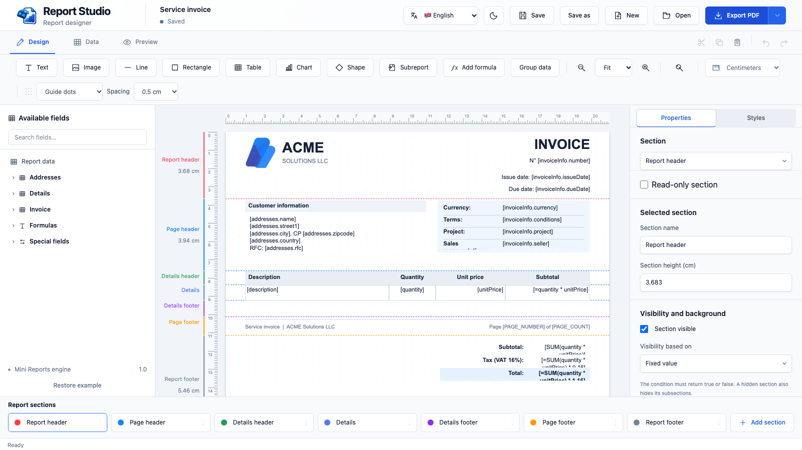
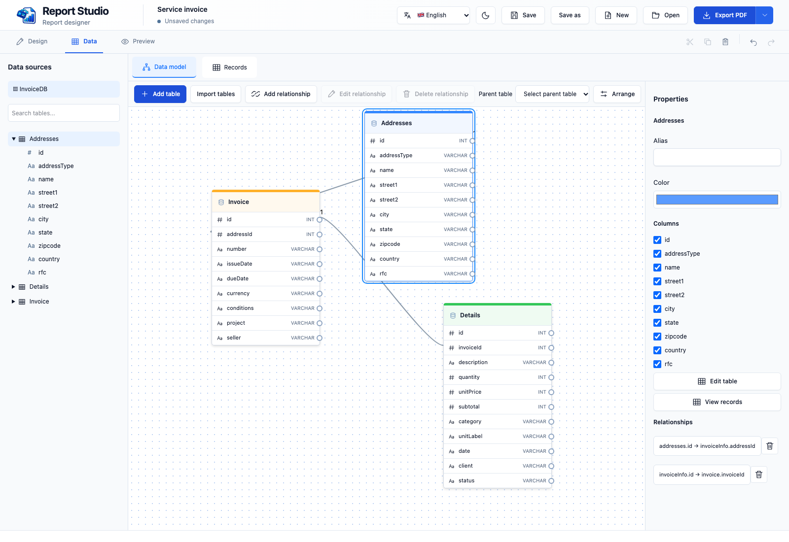
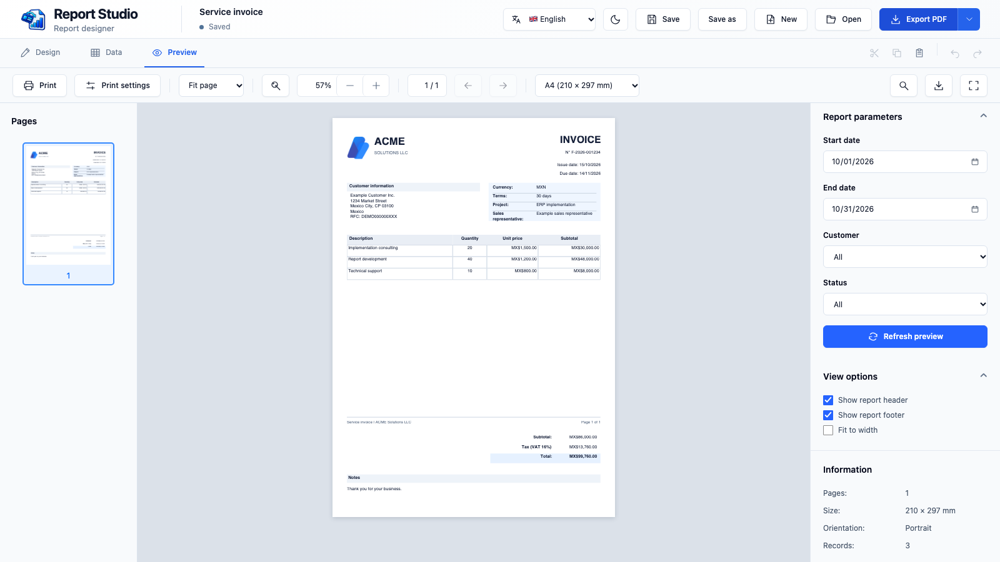

[English](README.md) · [Español](README.es.md) · [Français](README.fr.md)

# IntelligentReports Studio

Conçu et créé par **Luigimonsoft**.

Créé avec **Tauri 2** pour macOS, Windows et Linux.

**Concevez des rapports à partir de vos données, puis exportez-les en PDF.**



IntelligentReports Studio est un concepteur de rapports de bureau pour créer des documents réutilisables à partir de données. Construisez visuellement une facture, une liste ou un autre rapport, reliez ses champs à des tables et vérifiez le résultat avant l’export. Le modèle est enregistré en JSON pour être rouvert et modifié.

### Fonctionnalités

- **Conception visuelle :** organisez textes, images, lignes, formes, tableaux et graphiques dans les sections du rapport, des pages et des détails. Réglez propriétés, styles, règles et guides.
- **Modèle de données :** définissez tables et champs, reliez-les et consultez les enregistrements. Importez des définitions et des données JSON ou fournissez-les par une intégration.
- **Contenu dynamique :** liez des champs, utilisez formules et paramètres, regroupez les détails et contrôlez la visibilité et le fond des sections.
- **Aperçu et diffusion :** consultez les pages, ajustez la vue, imprimez et exportez en PDF.
- **Interface adaptable :** disponible en français, anglais et espagnol, avec thèmes clair et sombre.

### Modéliser et fournir les données

Dans **Modèle de données**, créez des tables et définissez leurs champs et leurs types dans l’éditeur. Organisez les tables visuellement et reliez leurs colonnes pour établir des relations. Vous pouvez aussi importer des définitions de tables et des enregistrements facultatifs depuis un fichier JSON, ou coller le JSON dans la boîte d’importation.



Utilisez **Enregistrements** pour consulter et modifier les données disponibles. Dans **Conception**, faites ensuite glisser les champs vers le rapport ou liez-les à un tableau ou à une section de détails. L’aperçu utilise les enregistrements disponibles pour remplir le rapport. L’enregistrement normal conserve le schéma et le nom de la source, mais exclut les enregistrements ; une intégration peut fournir à nouveau les données au besoin.

### Du canevas à l’aperçu

Créez un rapport comme dans les autres outils de conception visuelle : faites glisser les champs et les éléments sur la page, déplacez-les entre les sections et réglez leurs propriétés et styles. Reliez le modèle à vos données, puis ouvrez **Aperçu** pour voir les pages obtenues avec les champs, formules et enregistrements répétés résolus. Vous pouvez ainsi vérifier le résultat avant de l’imprimer ou de l’exporter en PDF.



### Fonctionnement

1. Dans **Conception**, organisez la page et ses sections, ajoutez des éléments et réglez leur contenu et leur apparence.
2. Dans **Données**, définissez tables, champs, relations et paramètres. Une section ou un tableau peut répéter du contenu pour chaque enregistrement.
3. Dans **Aperçu**, le moteur associe le modèle aux données, évalue les expressions et répartit le contenu sur les pages. L’aperçu et l’export utilisent la même génération PDF.
4. Enregistrez le modèle JSON pour le modifier plus tard. L’enregistrement normal conserve la conception et les définitions de données, mais exclut les enregistrements et les valeurs de paramètres marquées comme non enregistrables. Les copies de récupération sont locales et peuvent contenir les données de session.

Tauri gère la fenêtre et les opérations système ; Leptos présente l’interface et le moteur intégré traite les données, la validation et la mise en page. Une facture d’exemple est chargée en développement ; la version distribuée démarre avec un rapport vierge.

## Installation et démarrage

Installez Rust, Node.js, Tauri CLI 2, Trunk 0.21.14 et wasm-bindgen-cli 0.2.126, ainsi que les [prérequis Tauri](https://v2.tauri.app/start/prerequisites/).

```sh
rustup target add wasm32-unknown-unknown
cargo install --locked trunk --version 0.21.14
cargo install --locked wasm-bindgen-cli --version 0.2.126
cargo install tauri-cli --version '^2'
cargo tauri dev
```

Pour créer une version distribuable, exécutez `cargo tauri build`. Sur un disque externe contenant des fichiers auxiliaires `._*`, `node scripts/clean-build.mjs dev` démarre une copie temporaire.

Les modèles JSON enregistrent les définitions des tables et les noms des sources, mais pas leurs données. Les fichiers de récupération sont locaux et peuvent contenir les données de la session.

Consultez le [README principal](README.md) pour la structure et les commandes de test.

Le JSON enregistré utilise `schemaVersion: 1`. Les anciens modèles sans cette propriété sont lus comme version 1 ; les versions de schéma non prises en charge sont rejetées. Les champs existants `version` à la racine et `report.version` restent obligatoires.

Lors de l’import JSON, activez **Développer le JSON imbriqué en tables liées** pour convertir une propriété comme `customer.name` en colonne modifiable `customer_name`, et `items[].price` en colonne d’une table enfant liée. Le schéma conserve le chemin d’origine dans `sourcePath` ; les expressions du rapport utilisent le nom de colonne généré. Les tableaux doivent contenir des objets. Un tableau vide produit une table liée vide avec des clés générées. Les données restent dans la session.

Dans **Conception → Champs disponibles → Modèles d’exemple**, choisissez une facture, un devis, une liste de produits ou un rapport de ventes. Les exemples utilisent des données de session modifiables ; les modèles enregistrés ne contiennent pas les enregistrements.

Les sections principales de détails et le pied du rapport acceptent `pageBreakBefore: true` pour commencer sur une nouvelle page. Dans un détail répété, le saut s’applique à chaque enregistrement et les en-têtes de groupe accompagnent le contenu. Ce réglage ne s’applique pas aux en-têtes du rapport ou de page, aux pieds de page ni aux sous-sections.

## Prochaines étapes

Une prochaine étape proposée est de créer une famille de bibliothèques et d’intégrations capables de générer des rapports à partir des modèles JSON créés dans IntelligentReports Studio. L’objectif est que chaque application fournisse ses propres données et génère le rapport sans nécessiter le concepteur de bureau à l’exécution.

Les plateformes et technologies proposées sont **.NET, Visual C++, SwiftUI, Rust, Tauri, React et Angular**. Les API, les fonctionnalités prises en charge et le calendrier restent à définir. Il s’agit de projets ; ces bibliothèques ne sont pas encore incluses dans ce dépôt.

## Contribuer

1. Ouvrez une issue décrivant le problème ou la proposition, avec le système et les étapes de reproduction si nécessaire.
2. Créez un fork et une branche consacrée à un changement précis.
3. Respectez la structure des composants, placez les textes visibles dans les catalogues et exécutez les vérifications adaptées. Ajoutez des captures pour les changements visuels.
4. Ouvrez une pull request expliquant le comportement, sa raison et les vérifications effectuées. N’incluez pas de secrets, de données privées ni de dossiers générés.

### Contribuer aux traductions ou ajouter une langue

1. Utilisez `app/src/i18n/en.json` comme source et créez ou mettez à jour le catalogue dans `app/src/i18n/`. Conservez les clés, paramètres et expressions ; traduisez les valeurs.
2. Pour une nouvelle langue, enregistrez le catalogue dans `app/src/i18n/mod.rs` et ajoutez-la au sélecteur dans `app/src/header/mod.rs`, avec une étiquette accessible et un drapeau adapté.
3. Examinez `runtime/i18n/` et ses utilisations pour les noms de sections et les requêtes. Ajoutez les traductions nécessaires et lancez `npm run build` dans `runtime/` si le moteur change.
4. Mettez à jour le README de la langue et les liens initiaux des trois README. Vérifiez les textes longs, dialogues, menus natifs, dates, nombres et le repli linguistique.
5. Validez le JSON et exécutez les vérifications adaptées. Signalez les termes restant à traduire dans la pull request.

## Licence

[MIT](LICENSE).
