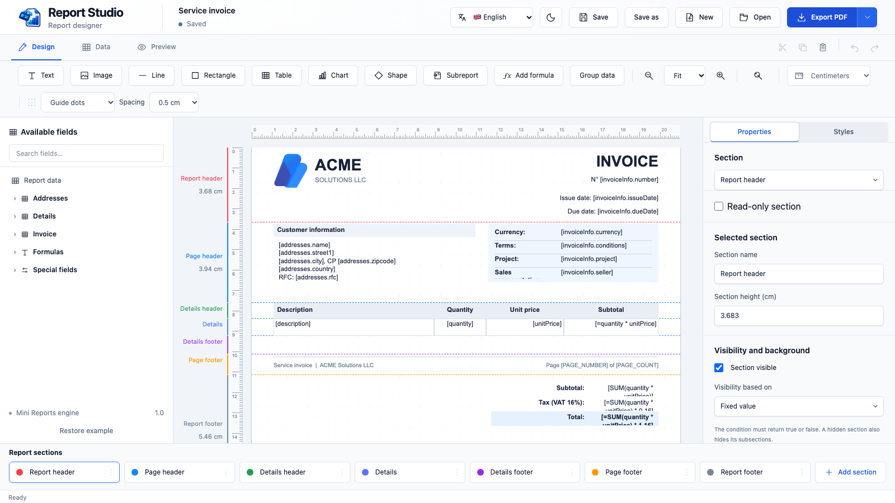
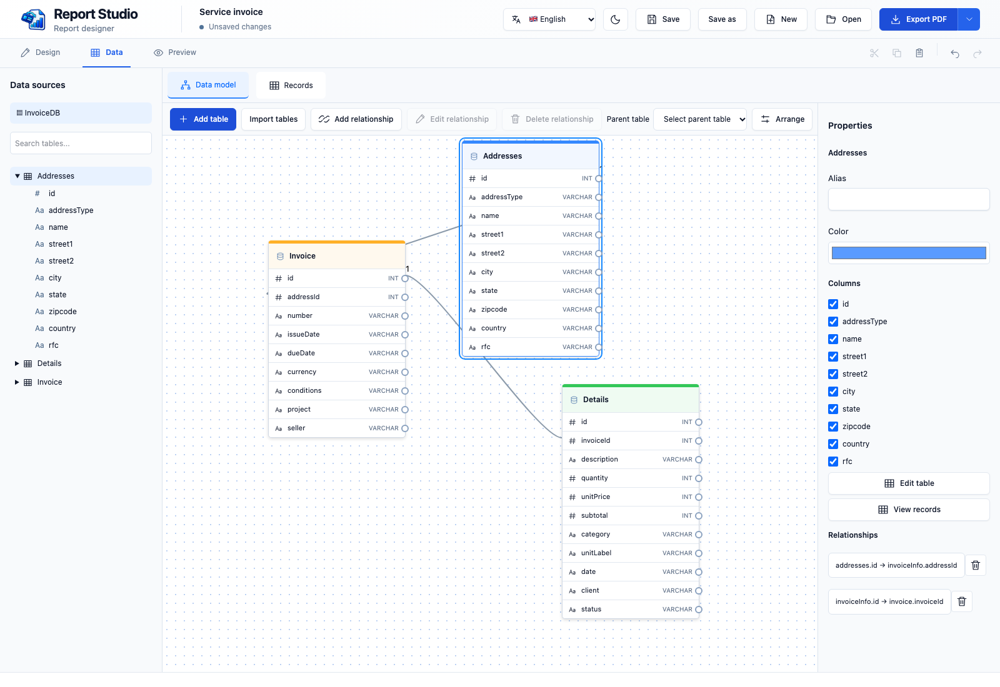
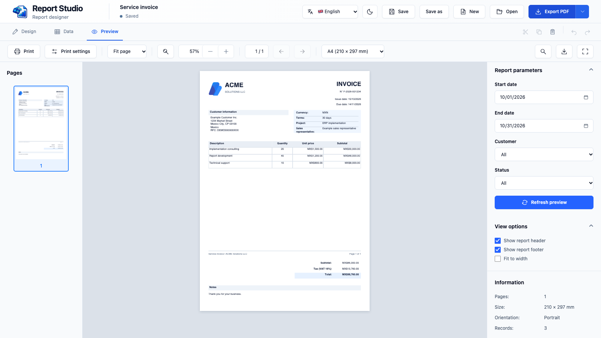

[English](README.md) · [Español](README.es.md) · [Français](README.fr.md)

# IntelligentReports Studio

Designed and created by **Luigimonsoft**.

Built with **Tauri 2** for macOS, Windows and Linux.

**Design reports around your data, then take them from the canvas to PDF.**



IntelligentReports Studio is a desktop report designer for creating reusable, data-driven documents. Build an invoice, listing or other report visually, connect its fields to tabular data, and preview the result before exporting it. A report is stored as a JSON template, so its design can be opened and edited again.

### What you can do

- **Design visually:** arrange text, images, lines, shapes, tables and charts in report, page and detail sections. Adjust properties, styles, rulers and guides as you work.
- **Model your data:** define tables and fields, connect relationships and inspect records. Import table definitions and records from JSON or supply data through a host integration.
- **Make reports dynamic:** bind fields, add formulas and parameters, group details and control section visibility and backgrounds.
- **Review and share:** preview paginated output, adjust the view, print and export to PDF.
- **Work in your language:** use the English, Spanish or French interface and choose a light or dark theme.

### Model and supply your data

In **Data model**, create tables and define their fields and types through the table editor. Arrange tables visually and connect columns to define relationships. You can also import table definitions and optional records from a JSON file, or paste the JSON into the import dialog.



Use **Records** to inspect and edit the available data. Back in **Design**, drag fields onto the report or bind them to a table or detail section. The preview uses the available records to populate the report. Normal template saves retain the schema and source name while excluding records; a host integration can supply data again when needed.

### From canvas to preview

Build a report much like you would in other visual design tools: drag fields and elements onto the page, move them between sections, and adjust their properties and styles. Connect the design to your data, then open **Preview** to see the resulting pages with fields, formulas and repeated records resolved. You can review the output before printing or exporting the PDF.



### How it works

1. **Design** the page and its sections. Drag fields or add elements, then set their content, size and appearance.
2. **Data** defines tables, fields, relationships and parameters. A section or table can use a data source to repeat content for records.
3. **Preview** combines the template and available data, evaluates expressions and lays out pages. The same PDF generation path supplies the preview and PDF export.
4. **Save** the template as JSON and reopen it for later changes. Normal template saves retain the design and data-source definitions, but exclude table records; parameter values marked not to save are excluded too. Recovery copies are local and may contain session data.

Tauri provides the desktop window and system operations. The Leptos interface runs in the WebView, while a bundled report engine handles validation, data processing, layout and PDF generation. The included sample invoice is for development; release builds start with a blank report.

## Requirements

Install Rust, Node.js, Tauri CLI 2, Trunk 0.21.14 and wasm-bindgen-cli 0.2.126. Install the [Tauri prerequisites](https://v2.tauri.app/start/prerequisites/) for your platform.

```sh
rustup target add wasm32-unknown-unknown
cargo install --locked trunk --version 0.21.14
cargo install --locked wasm-bindgen-cli --version 0.2.126
cargo install tauri-cli --version '^2'
cargo tauri dev
```

`cargo tauri dev`, `cargo tauri build`, and `node scripts/frontend.mjs` build the report runtime automatically before Trunk. If locked runtime dependencies are missing or have changed, the script runs `npm ci` in `runtime/` (the first installation may require network access). The packaged application works without Node.js. Generated `chunk-*.js` and `sample-*.js` files do not need to be committed.

On external drives containing macOS `._*` metadata, the project build configuration selects only valid permission and capability files. To create a clean snapshot and run it instead, use `node scripts/clean-build.mjs dev`.

## Build

```sh
cargo tauri build
```

The frontend build generates the browser runtime in `public/vendor`. To rebuild it manually:

```sh
cd runtime
npm ci
npm run build
```

## Tests

```sh
cargo test -p app
cargo test -p intelligent_reports_studio --lib
cd runtime && npm ci && npm test
```

Browser tests are in `end2end`; install their dependencies with `npm ci` and run them against the development server.

## Project layout

- `app/`: Leptos interface and report state.
- `frontend/`: WebAssembly entry point.
- `src-tauri/`: desktop integration, native dialogs and file operations.
- `runtime/`: report engine, data model, PDF generation and formulas.
- `public/`: styles and compiled browser assets.
- `end2end/`: browser integration tests.

Reports are JSON documents. Saved templates contain table definitions and source names; table records are excluded. Parameters can be configured not to persist their values. Recovery files are stored locally and may contain the current session's data.

Saved report JSON uses `schemaVersion: 1`. Older templates without this property are read as version 1; unsupported schema versions are rejected. The existing root `version` and `report.version` fields remain required.

When importing JSON, enable **Expand nested JSON into related tables** to turn a path such as `customer.name` into an editable column such as `customer_name`, and `items[].price` into a column in a related child table. The schema retains the original path as `sourcePath`; report expressions use the generated column name. Arrays must contain objects. Empty arrays produce an empty related table with generated key columns. Data is session-only.

After loading a JSON data file for any table in an expanded source, **Reload data** updates the entire related group atomically, including regenerated parent and child keys. The schema stores the group and original array paths in `schema.nestedSource`, while records and the selected file path are not saved in the report. A newly introduced field or array requires a new import; reload only fills the existing schema. Generated keys depend on record order, so relationships from those keys to tables outside the imported group must be removed before reloading. For older imports, the existing structure must be identifiable from the original fields and relationships.

In **Design → Available fields → Example templates**, choose an invoice, quotation, product list or sales report. Examples use editable session data; saved templates do not include table records.

Root detail sections and the report footer support `pageBreakBefore: true` to start on a new page. On a repeating detail, the break applies to each record; repeating group headers move with the content. Page headers, page footers, the report header, and nested sections do not support this setting.

## Future plans

A planned next step is a family of libraries and integrations that can generate reports from the JSON templates created in IntelligentReports Studio. The goal is to let applications supply their own data and generate a report without requiring the desktop designer at runtime.

Proposed targets are **.NET, Visual C++, SwiftUI, Rust, Tauri, React and Angular**. The exact APIs, supported features and release schedule are still to be defined. These are plans, not libraries currently included in this repository.

## Contributing

Contributions are welcome, whether you fix a bug, improve the documentation, add a feature or report a reproducible problem.

1. Open an issue describing the problem or proposed change, including platform and steps to reproduce when applicable.
2. Fork the repository and create a branch for a focused change.
3. Follow the existing component structure and keep user-facing text in the translation catalogs. Run the checks relevant to your change and include screenshots for visible changes.
4. Open a pull request describing the behavior, the reason for the change and how you verified it. Do not include credentials, private report data or generated build directories.

### Adding or improving a language

1. Use `app/src/i18n/en.json` as the source of English keys. Create or update the target catalog in `app/src/i18n/`; preserve keys, placeholders and expression syntax, and translate values only.
2. For a new language, register its catalog and language code in `app/src/i18n/mod.rs`, then add it to the selector in `app/src/header/mod.rs`. Include a suitable accessible label and flag.
3. Review the runtime catalogs in `runtime/i18n/` and their consumers, including report section names and data queries. Add support where that language needs runtime-specific translations. Rebuild the runtime with `npm run build` inside `runtime/` when its files change.
4. Update the corresponding README and the language links at the top of all three READMEs. Check long labels, dialogs, native menu labels, date and number formats, and fallback behavior in the application.
5. Validate JSON syntax and run the relevant checks. Explain any untranslated terms or limitations in the pull request.

## License

[MIT](LICENSE).
